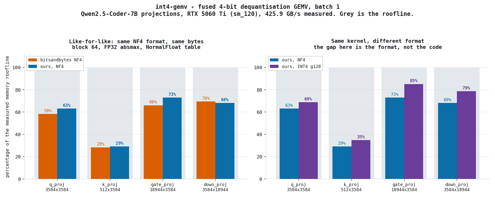

# int4-gemv

A hand-written CUDA kernel for the hot path of quantised LLM decode: `y = W·x`
where `W` is 4-bit and the dequantisation is **fused into the load**, so FP16
weights are never materialised in memory.

Two formats, because only one of them makes an honest comparison possible.

<p align="center">
  
</p>

## The result

Measured on an RTX 5060 Ti (sm_120 Blackwell, 36 SMs), on the seven real
projection shapes of Qwen2.5-Coder-7B at batch 1, against bitsandbytes in
**exactly its own format** — NF4, block 64, FP32 absmax, the canonical
NormalFloat table, verified against its `quant_state`.

```
shape            out x in   roofline    bnb NF4    our NF4    bnb %BW  our %BW   ratio
q_proj          3584x3584      17.0u      29.1u      26.8u      58.3%    63.2%   1.08x
k_proj           512x3584       2.4u       8.5u       8.3u      28.4%    29.1%   1.03x
gate_proj      18944x3584      89.7u     135.7u     122.9u      66.1%    72.9%   1.10x
down_proj      3584x18944      89.7u     129.0u     131.7u      69.5%    68.1%   0.98x  <- bnb wins
```

**1.03–1.10×, and it loses on `down_proj`.** That is the number.

## The number it is not

Comparing our INT4 kernel against bitsandbytes NF4 gives **1.23–1.41×**, and
that is the figure this README would carry if the NF4 variant had never been
written. It is confounded:

| | INT4 (ours) | NF4 (bitsandbytes, and ours) |
|---|---|---|
| grouping | 128 | 64 |
| scale | FP16 | FP32 |
| scale traffic | 0.125 bit/weight | 0.5 bit/weight |
| dequantisation | one multiply | 16-entry lookup |

Fewer bytes and a cheaper decode. Holding the kernel constant and changing only
the format costs **19–31 %**:

```
shape           our INT4      our NF4   format cost
q_proj             22.6u        26.8u         18.7%
k_proj              6.4u         8.3u         30.7%
gate_proj          96.6u       122.9u         27.3%
down_proj         104.5u       131.7u         26.0%
```

So most of the 1.4× was the format, not the code. Reporting it as a kernel
speedup would have been crediting a choice of problem to the implementation.
`bench/compare.py` prints all three tables with that spelled out.

## The kernel

One warp per output row. The 32 lanes stride the reduction dimension in `uint32`
words — 8 codes per load, fully coalesced 128-byte transactions — dequantise in
registers, accumulate in FP32, and close the row with `__shfl_down_sync`.

The NF4 variant's only real difficulty is the lookup. A 16-entry table read from
memory with divergent indices serialises, so it lives in the register file
instead: lane *L* holds entry *L*, and `__shfl_sync` with a per-thread source
lane turns the warp into the table — one instruction per lookup, no memory
traffic, no bank conflicts.

```cuda
const float lut = (lane < 16) ? NF4_TABLE[lane] : 0.0f;
...
const int code = (packed >> (k * 4)) & 0xF;
const float wv = __shfl_sync(0xffffffffu, lut, code) * s;
acc = fmaf(wv, __half2float(__ldg(&x[base + k])), acc);
```

Every lane runs the same iteration count: `__shfl_sync` is undefined if a lane
in the mask has already exited, and `in_f` does not guarantee a word count
divisible by 32.

No tensor cores, deliberately. At batch 1 `mma` needs M ≥ 8, so seven eighths of
every tile would be padding — and this kernel is memory-bound, which is not a
problem tensor cores solve. Recorded in the ADR so it does not get re-litigated.

## Where this came from, and where it went wrong

[Unibit](https://github.com/QuantumDrizzy/unibit) measured decode at ~6 % of the
bandwidth roofline and attributed the gap to dequantisation arithmetic. This
repository was started to close that gap. It has now been wrong twice, and both
are on the record:

1. **The premise.** The harness, written before any CUDA, showed bitsandbytes
   already at 58–70 % of roofline on the isolated GEMV. The dequant kernel is not
   where the 15× goes. Headline corrected from 15× to ~1.5× in
   [ADR-0001](docs/ADR-0001-the-kernel.md), above the reasoning it invalidates.
2. **The result.** The first kernel looked like 1.4× over bitsandbytes. Writing
   the like-for-like NF4 variant cut that to 1.1× with a loss on one shape.

What survived both: **fusion is worth 3–6×.** Dequantising to FP16 and calling
cuBLAS costs 88.3 µs against 29.1 µs at 3584×3584, and 793.4 µs against 135.7 µs
at 18944×3584.

## Method

- Every timing gated on correctness first, against an FP32 CPU reference computed
  on the **dequantised** weights — so it tests the kernel's arithmetic and layout,
  not the quantiser's accuracy. Max relative error 1.6–2.1 × 10⁻⁴; the gate
  rejects above 2 × 10⁻².
- CUDA-event timing, 25 warmup iterations, median of 300.
- Bandwidth measured on the device at run time, not quoted from a datasheet.
- The empty-launch floor (5.28 µs) is measured and stated separately, because at
  `k_proj` and `v_proj` it *is* most of the measurement.

## Build and run

```bash
scripts\build.bat          # vcvars64 + nvcc -O3 -arch=sm_120
int4_gemv.exe              # both kernels -> bench/kernel.json

python bench/baseline.py   # roofline, cuBLAS FP16, bitsandbytes NF4, control A
python bench/compare.py    # the three tables
python bench/plot.py       # the figure
```

`bench/baseline.py` needs PyTorch and bitsandbytes. The kernels need only nvcc.

## Limits

- One GPU, one architecture (sm_120). The split-K variant in the ADR, for shapes
  too narrow to fill the device, is not implemented.
- Batch 1 only. This is decode; prefill is a different, compute-bound problem.
- `down_proj` loses to bitsandbytes and is not yet understood. The reduction
  dimension is 18944 there against 3584 elsewhere, so the per-row working set and
  the tail behaviour differ — that is a hypothesis, not a diagnosis.
- Our NF4 packing is 8 codes per `uint32`; bitsandbytes packs 2 per byte. Same
  bytes moved and the same numerical format, but not a byte-identical layout.
- No fused activation, no bias, no attention, no KV-cache. One kernel, not an
  inference engine.

## Licence

Proprietary. Copyright (c) 2026 Antonio Zambudio Rodriguez, all rights reserved.
See [LICENSE](LICENSE). Visibility of this repository does not grant a licence to
use, copy or derive from it.
